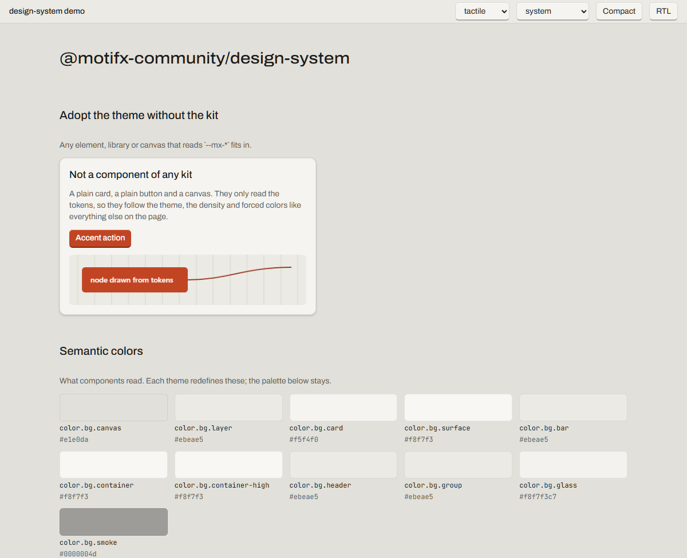

# motifjs-design-system

[](https://www.npmjs.com/package/@motifx-community/design-system)
[](https://github.com/motifjs-community/motifjs-design-system/actions/workflows/ci.yml)
[](LICENSE)

`@motifx-community/design-system` is the design foundation for **MotifJS** (`@motifx/core`), the UI framework whose view is a live object tree, not a description of one: design tokens, themes, base styles, the design language typefaces and accessibility preferences that every MotifJS component library and app builds on.

[Live demo](https://motifjs-community.github.io/motifjs-design-system/) · [The components built on it](https://ui.motifjs.com)



It contains no components. It is the shared vocabulary: a component library such as `@motifx-community/ui`, a chart or a flow-diagram library, or a plain `<div>` in your app all read the same `--mx-*` custom properties, so they look like one product and follow the same theme, density and user preferences. The package has no runtime dependency, not even on `@motifx/core`: the CSS works anywhere, the small TypeScript entry only types the token names and writes attributes.

## Install

> **Preview** (`beta`): token names may still change before 1.0; a change is announced in the changelog.

```sh
npm i @motifx-community/design-system@beta
```

## 30 seconds

```ts
// main.ts
import '@motifx-community/design-system/styles.css'; // reset + fonts + tokens + themes + base styles
import { setTheme, cssVar } from '@motifx-community/design-system';

setTheme('dark'); // writes data-theme="dark" on <html>; 'system' follows prefers-color-scheme
document.querySelector('button')!.style.background = cssVar('color.accent.solid'); // typo-safe
```

```css
/* your.css: write styles against tokens, never against values */
.card {
  background-color: var(--mx-color-bg-card);
  color: var(--mx-color-fg-primary);
  border: var(--mx-border-width-1) solid var(--mx-color-stroke-card);
  border-radius: var(--mx-radius-lg);
  padding: var(--mx-space-4);
  box-shadow: var(--mx-shadow-4);
}
```

That card is dark in the dark theme, black-and-white in `data-theme="high-contrast"`, opaque under reduced transparency and drawn in system colors under Windows high contrast, without a line of code about any of it.

## Concepts

**Four layers.** *Primitive* tokens are the shared palette and scales (`color.gray.95`, `space.4`); components never read them. *Design language* tokens are what a language brings of its own: corner radii, shadows, type and motion (`radius.md`, `shadow.4`, `font.family.sans`, `motion.duration.fast`), the same names in every language with that language's values. *Semantic* tokens give the palette meaning per theme (`color.bg.canvas`, `color.fg.primary`, `color.accent.solid`, `focus.ring.color`) and are what components use. *Density* tokens (`control.height.md`, `control.padding.md`, `control.gap`) size controls. A component library adds a fifth layer of its own, component tokens, which reference these.

**The CSS custom properties are the API.** `--mx-color-bg-canvas` is a public name, in `@layer mx.tokens`. Adding tokens is a minor release; removing or renaming one is a major release announced one minor ahead with `$deprecated`. The TypeScript side (`tokens`, `TokenName`, `cssVar`) is a typed view of the same names, not a second API.

**Themes are attribute scopes, not providers.** `data-theme="light|dark|high-contrast"` on `<html>` or on any element switches the semantic tokens for that subtree, and `data-density="compact"` the control sizes. With no attribute, light is the default and dark follows `prefers-color-scheme`. Nested scopes work: a dark sidebar in a light app is one attribute.

**A design language is an attribute too.** `data-design-language="lounge"` picks the language: its radii, shadows, type, motion, colors per theme and control sizes per density, under the very same token names. Without the attribute the default language applies. A language scope starts from that language's default theme and follows the system like the root does; write `data-theme` on the same element to pin a theme, and theme or density scopes below it take that language's values. A theme the language does not ship falls through to the default language's theme of that name, so `data-theme="high-contrast"` always wins. Five languages ship today: Tactile (the default), Lounge, Material, Fluent and Lilac. Each one also draws the selected or current item of a list, a tree or a navigation menu its own way: colors and a surface effect per theme (`color.selection.bg`, `fg`, `border`, `indicator`, `effect.selection`) and a shape per language (`item.radius`, the same in every state, `selection.border-width`, `indicator.thickness`, `indicator.length`, `indicator.radius`). Fluent: a quiet fill with WinUI's 3 by 16 px accent pill. Material: the secondary container as a full pill, no bar. Lounge: a brass-tinted fill in a fine gold frame with brass text, no bar. Tactile: a raised key in its control fill, framed by the control stroke, with the inner top highlight and bottom edge of its pressable controls, no bar. A language draws only the parts it uses and zeroes the others. Other roles work the same way, one decision for every component at once: the focus visual's shadow (`focus.ring.halo`, and `focus.ring.halo-inset` for a ring drawn inside a box), a raised control's resting face (`effect.control`), the shadow level of each kind of surface (`elevation.card`, `popup`, `tooltip`, `toast`, `window`, `window-inactive`, `dialog`), and the colors of surfaces and fills only some languages tell apart: raised surfaces (`color.bg.container`, `color.bg.container-high`, Material's tonal containers), a table's header and group rows (`color.bg.header`, `color.bg.group`, opaque), a text field focused and disabled (`color.fill.input.focus`, `color.fill.input.disabled`), an opaque control fill (`color.fill.control.solid`), a check box or radio's quieter fill (`color.fill.control-alt.default`, `secondary`, `tertiary`, `disabled`) a neutral notice (`color.info.subtle`) and text or a shape on the accent's quiet fill (`color.accent.on-subtle`, Material's on-primary-container). A language without its own value maps each to one it already has.

**User preferences are token overrides.** `prefers-reduced-motion` zeroes the motion durations, `prefers-reduced-transparency` makes the translucent fills opaque, and `forced-colors: active` maps every semantic color to a CSS system color (`Canvas`, `CanvasText`, `Highlight`, …). A canvas or SVG library that reads the tokens gets the right colors in every mode.

**One source, standard tooling.** The source is DTCG 2025.10 JSON in `tokens/` (shipped in the package, importable by Figma, Tokens Studio and other tools) with a Resolver Module document describing sets and modifiers. [Style Dictionary 5](https://styledictionary.com) builds it; a WCAG contrast gate (AA in light and dark, AAA in high contrast) runs in every build and fails it on a bad pair. A second check keeps the status colors apart for color-blind readers: success, caution and danger text must stay distinct for a deuteranope and a protanope too (OKLab distance, Machado 2009 simulation). It blocks the build for Tactile, Lounge, Lilac and every new language; for Material and Fluent it reports, since they take their colors from their sources.

**Three cascade layers.** `@layer mx.reset, mx.tokens, mx.base;` is declared first. Component libraries put their CSS in a later layer of their own; any un-layered CSS an app writes wins over everything the packages ship.

**Tactile, the default language.** Warm neutral greys with a hint of linen rather than pure grey, one signal-orange accent, matte surfaces, and controls that look pressable: an opaque fill, a visible bottom edge (`control.edge.width`, `color.stroke.control.edge`), an inner top highlight (`color.highlight.control`) and a press offset (`control.press.offset`). Text is Archivo, one variable family whose width axis the `font.width.*` tokens drive: the wide cut for titles, the regular cut for text, a narrow cut for dense tables; code is JetBrains Mono. Both ship with the package (`fonts.css`, latin and latin-ext). The one translucent surface is `color.bg.glass`, for a command palette, popover or toast floating over content; it becomes `color.bg.surface` under reduced transparency. App bars read `bar.height` and `color.bg.bar`. The Fluent 2 values the package started from are kept in `tokens/presets/windows/` as the start of a later language; they are not built.

**Lounge, the premium language.** Warm blacks (`color.ink.*`) and ivory text (`color.ivory.*`), a brass and gold accent (`color.brass.*`), chrome hairline strokes on controls and a fine gold hairline on cards and surfaces. Controls are capsules: `radius.md` is half the medium control height, so one-line controls are fully round and a multi-line field gets soft corners. Shadows are deep, clean black, controls are a little taller, Archivo is set a little narrower for a tailored look and motion is slower and smoother. Dark only for now; it uses the same token names as Tactile, so any kit follows it without a line of code.

**Material, based on Material Design 3.** Material Design is a design system by Google; this language is based on its published Material Design 3 guidelines and is not affiliated with or endorsed by Google. A violet accent (`#6442d6` light, `#9f86ff` dark), faintly violet neutrals for surfaces, text and outlines, and red, green and yellow for errors, success and caution. Google Sans Flex and Google Sans Code (both OFL) ship with the package; a 4, 8, 12, 16 and 28 px shape scale, soft two-layer elevation, its own type scale and motion; flat controls (no bottom edge, no press offset), 40 px buttons and 56 px large controls, a 3 px focus ring in muted slate. Light and dark follow the system like Tactile; high contrast falls through to Tactile's. Hover and pressed colors are state layers baked into opaque fills.

**Lilac, soft and calm.** A lilac accent (`#7550ad` light, `#d6baff` dark) on neutrals with a faint lavender tint, white cards and no pure black in the dark theme; jade for success, yellow for caution and a rose red for danger, kept apart in lightness as well as hue, with no orange or brown anywhere. Every color comes from HCT tonal ramps. Nunito Sans (variable, OFL) for text and Fraunces in its soft cut (OFL) for headings ship with the package; 15 px body text on 22 px lines; soft corners (6, 8, 12, 16 and 24 px); roomy flat controls (36 px, generous side space, no bottom edge, no press offset); soft, wide shadows with a lilac tint; a 2 px lilac focus ring with a soft halo; slower, smoother motion. The selected item is a soft lilac fill, no bar. Light and dark follow the system; high contrast falls through to Tactile's. Its palette and type draw on published color and type preference research among women (lilac and light tints over orange and brown, humanist type, soft corners) and on WCAG; it is meant for anyone who likes a soft, calm look. "Lilac" is a plain color name; it is not a registered mark of this project.

**Fluent, from WinUI 3.** Fluent is Microsoft's design system; this language is based on the published WinUI 3 theme resources (Fluent 2 for Windows) and is not affiliated with or endorsed by Microsoft. Its colors are generated from WinUI's own theme dictionaries (`ControlFillColorDefault`, `TextFillColorPrimary`, `CardBackgroundFillColorDefault` and the rest, which the semantic names here come from): text and the control fill are laid over the base background so the contrast gate can check them, strokes and hover fills stay translucent as in WinUI. Windows 11's default accent ramp (`#005FB8` light, `#60CDFF` dark), 4 px control and 8 px overlay corners, Segoe UI Variable from the system (not shipped), a 1 px elevation edge and no press offset, a 40 px menu bar. Light and dark follow the system; high contrast falls through to Tactile's.

## API

### CSS entry points

| Import | Contents |
| ------ | -------- |
| `@motifx-community/design-system/styles.css` | Everything below in one file, in order. Most apps import only this. |
| `…/fonts.css` | `@font-face` for Archivo (variable: weight and width) and JetBrains Mono (400, 500), latin and latin-ext; the woff2 files sit next to it under `…/fonts/`. Skip it to bring your own faces and override the `font.family.*` tokens. |
| `…/tokens.css` | Layer order, primitive tokens and the density scopes (`:root`, `[data-density]`). |
| `…/themes/auto.css` | Light on `:root`; dark under `prefers-color-scheme: dark` when no `data-theme` is set. |
| `…/themes/light.css`, `dark.css`, `high-contrast.css` | One `[data-theme="…"]` scope each, for the default language. |
| `…/design-languages/tactile.css`, `lounge.css`, `material.css`, `fluent.css` | One design language each under its `[data-design-language="…"]` scope: its scales, densities and themes. |
| `…/preferences.css` | Reduced motion, reduced transparency and forced-colors overrides. |
| `…/reset.css`, `…/base.css` | The reset; `color-scheme`, typography ramp, `:focus-visible` ring, slim scrollbars (`scrollbar.size`), `.mx-sr-only`, `.mx-forced-colors-none`. |

### TypeScript

| Export | Description |
| ------ | ----------- |
| `tokens` | Every token name → `{ cssVar, type, layer }`, `as const`. |
| `TokenName`, `TokenType` | Union types of the names and the DTCG types in use. |
| `cssVar(name)` / `cssProperty(name)` | `var(--mx-…)` / `--mx-…` for a token, checked at compile time. |
| `designLanguages`, `themes`, `densities`, `defaultDesignLanguage`, `defaultTheme`, `defaultDensity` | The shipped design language, theme and density names. |
| `setDesignLanguage(designLanguage, root?)`, `getDesignLanguage(root?)` | Write or read `data-design-language`; `'default'` removes it. |
| `setTheme(choice, root?)`, `getTheme(root?)`, `resolveTheme(root?)` | Write or read `data-theme`; `resolveTheme` turns `'system'` into what the user sees. |
| `setDensity(density, root?)`, `getDensity(root?)` | Write or read `data-density`. |
| `onSystemThemeChange(listener)` | Called when the OS switches light/dark; returns the unsubscribe function. |

### Data and tooling

| Import | Contents |
| ------ | -------- |
| `…/tokens/primitive/*.json`, `…/tokens/design-language/<language>/base.json`, `…/<language>/<theme>.json`, `…/<language>/density/*.json` | The DTCG 2025.10 source: the shared primitives, then per design language its scales, its themes and its densities. |
| `…/tokens/mx.resolver.json`, `…/tokens/lounge.resolver.json`, `…/tokens/material.resolver.json`, `…/tokens/fluent.resolver.json` | Resolver Module 2025.10, one document per language: sets, `theme` and `density` modifiers. |
| `…/tokens/presets/windows/` | The Fluent 2 (Windows 11) values the package started from; the start of a later language, not built. |
| `…/json/light.json`, `dark.json`, `high-contrast.json`, `density-compact.json`; `…/json/<language>/…` | Flat, resolved: name → `{ cssVar, type, layer, value, ref }`, for docs sites and tooling; the top level is the default language. |
| `…/stylelint` | A shareable stylelint config: colors, font families, z-index and motion must come from tokens. |

## For component libraries

Keep your component tokens in your own repository and reference the semantic layer. Build them with Style Dictionary, including this package's source so references resolve and typos fail the build:

```js
// build-tokens.mjs in your library
import StyleDictionary from 'style-dictionary';
import { createRequire } from 'node:module';

const ds = createRequire(import.meta.url).resolve('@motifx-community/design-system/package.json').replace(/package\.json$/, 'tokens/');

const sd = new StyleDictionary({
  include: [`${ds}primitive/*.json`, `${ds}design-language/tactile/base.json`, `${ds}design-language/tactile/light.json`, `${ds}design-language/tactile/density/comfortable.json`],
  source: ['tokens/button.json'], // { "button": { "radius": { "$type": "dimension", "$value": "{radius.md}" } } }
  platforms: {
    css: {
      transformGroup: 'css',
      prefix: 'mx',
      files: [{ destination: 'dist/button.css', format: 'css/variables', filter: (t) => t.isSource, options: { outputReferences: true } }],
    },
  },
});
await sd.buildAllPlatforms();
```

Only tokens from your `source` are written; references to this package stay as `var(--mx-…)` and resolve at runtime in whichever theme is active. Put your component CSS in a layer after `mx.base` (for example `@layer mx.components`) and lint it with the shared config:

```js
// stylelint.config.mjs
export default { extends: ['@motifx-community/design-system/stylelint'] };
```

## Coming from React / Vue

- **No `ThemeProvider`, no context.** A theme is an attribute. `setTheme('dark')` writes `data-theme` and the whole tree restyles through the cascade; a nested `data-theme` scopes a subtree.
- **No theme object in JavaScript.** `tokens['color.bg.canvas']` gives you a CSS variable name, not a color. The color lives in CSS and differs per theme and preference. Read a live value with `getComputedStyle(el).getPropertyValue(cssProperty(name))` when you really need it (canvas drawing).
- **No CSS-in-JS and no `styled(…)`.** Styles are CSS files that use `var(--mx-…)`. Variants are `data-*` attributes the component writes, not class name strings built in JavaScript.
- **No re-render on theme change.** Nothing runs; the browser recomputes the custom properties. Only code that drew with the tokens (a canvas) has to redraw, which is what `onSystemThemeChange` is for.
- **Dark mode is not a second stylesheet to toggle.** All themes and languages are always loaded; one attribute picks the active one, so the switch is synchronous and flash-free.

## Examples

`examples/basic` is a plain-DOM page generated from the token map: semantic colors and the palette, the type ramp, spacing, radius, elevation, density, and a card, a button and a canvas that are not components of any library but follow the theme because they read tokens. Run it with `npm run dev`. It is deployed to the [live demo](https://motifjs-community.github.io/motifjs-design-system/) on every push to `main`.

## Contributing

`npm install`, then `npm run check` runs the token build, typecheck, stylelint, tests, the package build and the example build. Edit tokens only in `tokens/*.json` (DTCG 2025.10 object values) and run `npm run build:tokens`; `src/generated/tokens.ts` is committed output. The setup, the checks and the rules a change follows are in [CONTRIBUTING.md](CONTRIBUTING.md).

## License

[MIT](LICENSE)
